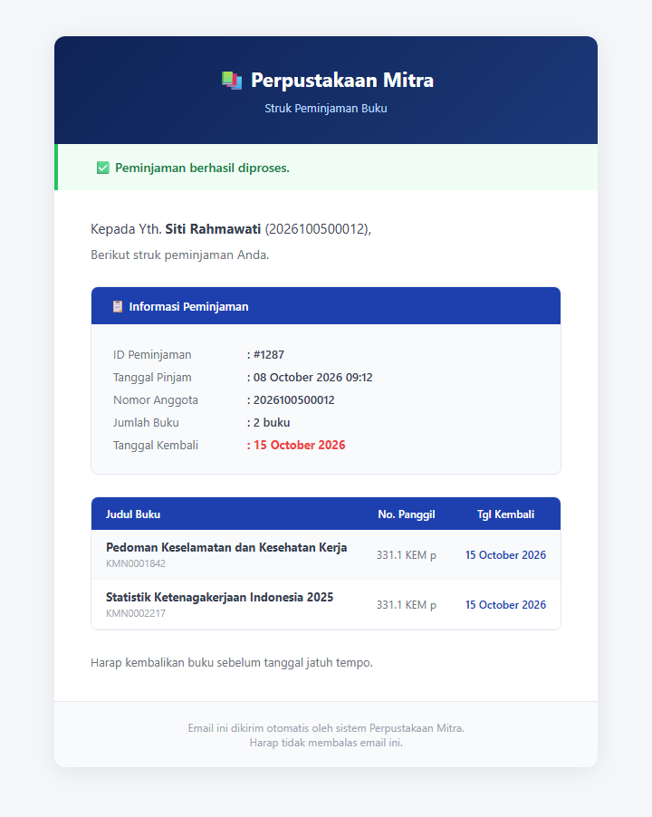
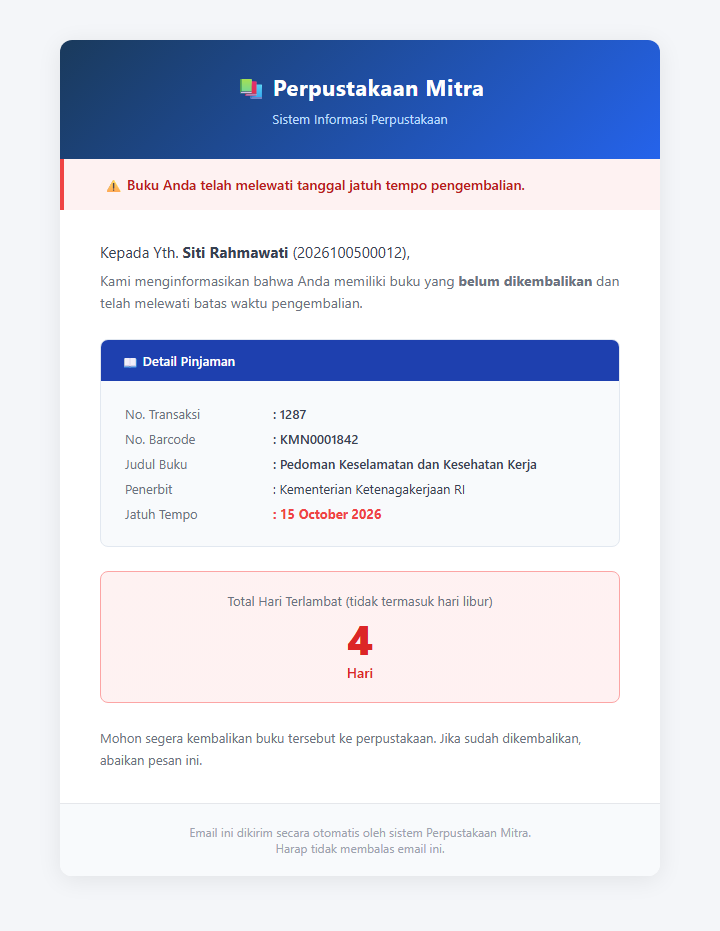
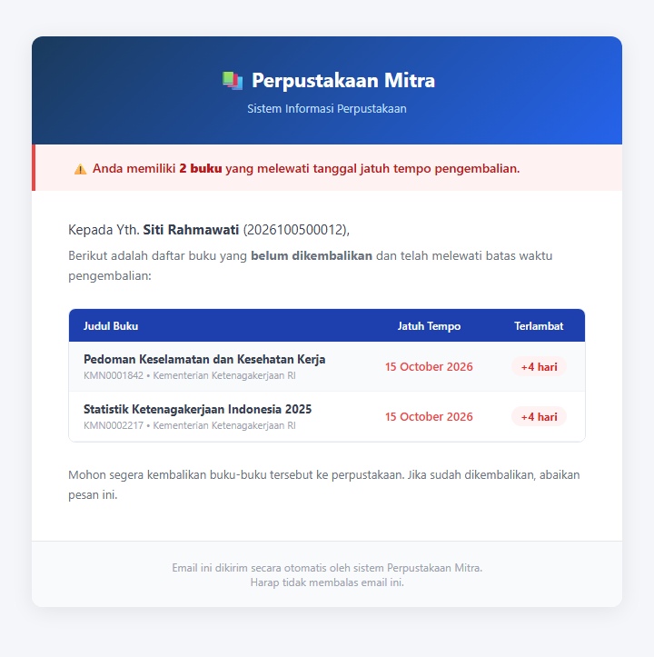
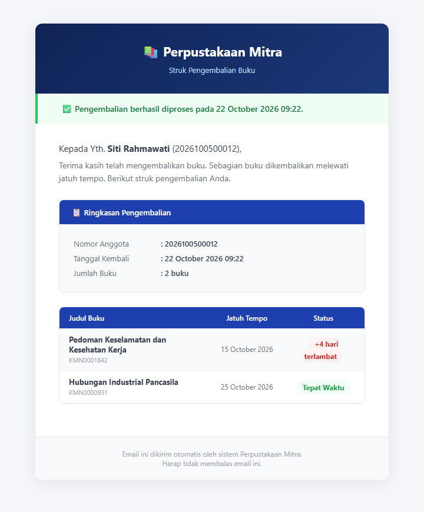
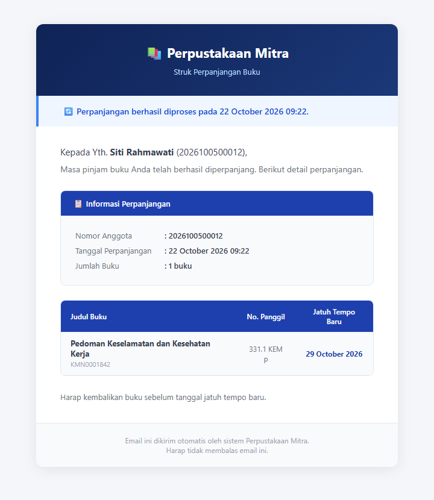
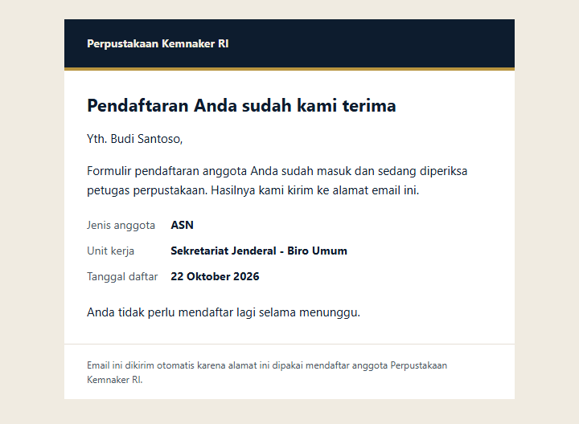
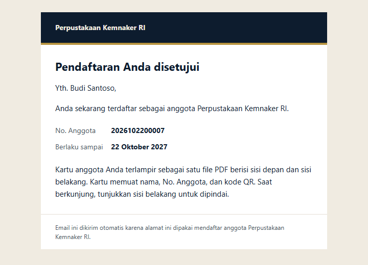
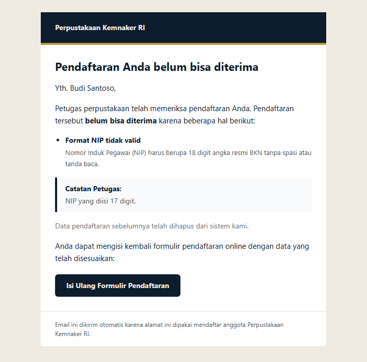

# Email yang dikirim sistem

Per 22 Oktober 2026 sistem mengirim **8 jenis email dari 4 fitur**. Semua email masuk ke alamat email anggota atau pendaftar, lewat SMTP yang diatur di `.env` (`email.SMTPHost`, `email.SMTPUser`, `email.SMTPPass`).

| Fitur | No. | Email | Subjek | Kapan terkirim |
|---|---|---|---|---|
| Peminjaman | 1 | Struk peminjaman | Struk Peminjaman Buku - ID #… | Petugas menyimpan peminjaman |
| | 2 | Peringatan keterlambatan | Notifikasi Keterlambatan Pengembalian Buku | Petugas menekan "Kirim Notifikasi Keterlambatan" pada satu peminjaman di daftar Peminjaman |
| | 3 | Peringatan keterlambatan, massal | Notifikasi Keterlambatan Pengembalian Buku | Petugas menekan "Kirim Notifikasi ke Semua" di daftar Peminjaman; satu email per anggota berisi semua bukunya yang terlambat |
| Pengembalian | 4 | Struk pengembalian | Struk Pengembalian Buku - tanggal jam | Petugas memproses pengembalian |
| Perpanjangan | 5 | Struk perpanjangan | Struk Perpanjangan Buku - tanggal jam | Petugas memperpanjang peminjaman |
| Pendaftaran Online | 6 | Pendaftaran diterima | Pendaftaran anggota Anda sudah kami terima | Pendaftar mengirim formulir pendaftaran online |
| | 7 | Pendaftaran disetujui | Pendaftaran disetujui, No. Anggota … | Petugas menyetujui pendaftar; kartu anggota terlampir sebagai satu PDF (sisi depan dan belakang) |
| | 8 | Pendaftaran belum bisa diterima | Pendaftaran Anda belum bisa diterima | Petugas menolak pendaftar, dengan alasan dan catatan; data pendaftar lalu dihapus |

Email 6 dan 7 juga bisa dikirim lagi dengan tombol "Kirim ulang email" di kolom Status Anggota kalau pengiriman pertama gagal. Isinya sama, jadi tidak dihitung terpisah.

Kode: email 1–5 di `app/Libraries/EmailNotificationLibrary.php`, email 6–8 di `app/Libraries/EmailPendaftaran.php` dengan tampilan `app/Modules/SubModule/Keanggotaan/Anggota/Views/email/pendaftaran.php`.

## Tampilan

Gambar dibuat dari template aslinya dengan data contoh (nama dan nomor rekaan), bukan dari kotak masuk. Nama perpustakaan di email 1–5 diambil dari pengaturan `NamaPerpustakaan`; di database lokal isinya "Perpustakaan Mitra".

### 1. Struk peminjaman

### 2. Peringatan keterlambatan

### 3. Peringatan keterlambatan, massal

### 4. Struk pengembalian

### 5. Struk perpanjangan

### 6. Pendaftaran diterima

### 7. Pendaftaran disetujui

### 8. Pendaftaran belum bisa diterima

## Tidak dihitung

Kode berikut masih ada, tetapi tidak ada tombol atau halaman yang memicunya sekarang:

- `sendMemberCard()`: kartu anggota lewat email untuk alur akun anggota lama (`member/activate`) dan route `anggota/kirim_kartu_digital` yang tidak punya tombol.
- `sendRegistrationReceived()`, `sendMembershipApproved()`, `sendRegistrationRejected()`: hanya dipakai perintah uji `php spark test:emailnotif`.
- `member_notify()`: aktivasi dan reset akun anggota versi lama.
- Email lupa kata sandi dan daftar akun admin: halaman login tidak menautkannya.
